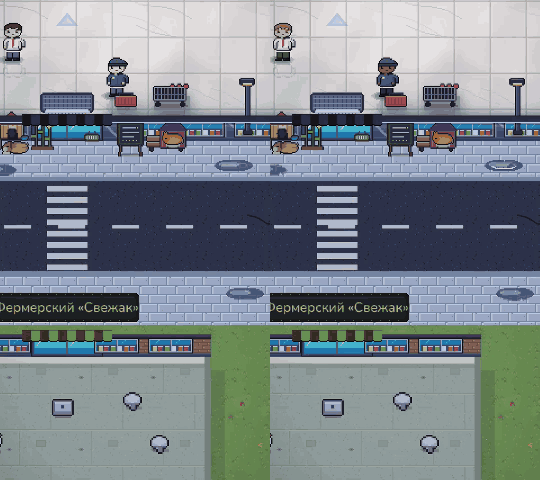
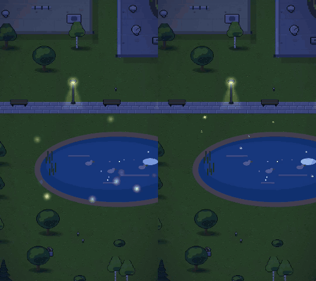
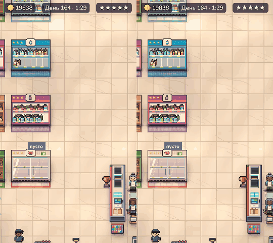
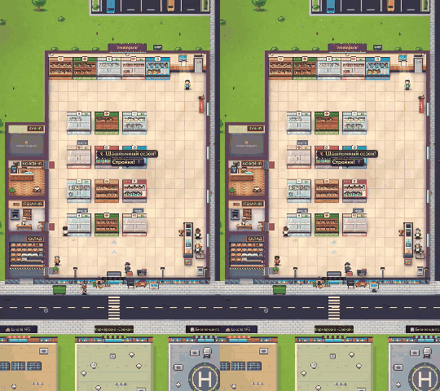
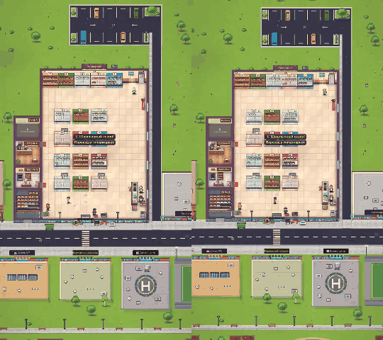
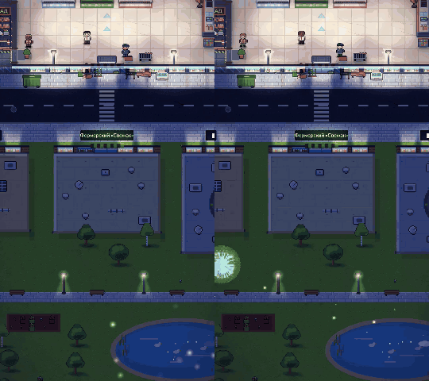

# Пилот pixelfx: пять эффектов, до и после

Эффекты из [pixelfx](https://github.com/patch-gg/pixelfx) (MIT, коммит a841596) запечены в кадры атласа скриптом
`scripts/fx-bake.mjs`: перекрашены в палитру игры, приведены к сетке рисунка. Вживую pixelfx в игре не работает.
Съёмка — `scripts/promo/pixelfx-pilot.cjs`: телефон 360×640 @3x, кадр за кадром; в роликах слева «до» (main), справа «после».

| Эффект | Ролик | Лист кадров | Кадры эффекта |
|---|---|---|---|
| Рябь на лужах в дождь (`water/ripples`) | [rain_compare.mp4](rain_compare.mp4) ·  | [rain_contact.jpg](rain_contact.jpg) | [sheets/ripple.png](sheets/ripple.png) |
| Светлячки летней ночью (`weather/fireflies`, только сам светлячок) | [fireflies_compare.mp4](fireflies_compare.mp4) ·  | [fireflies_contact.jpg](fireflies_contact.jpg) | [sheets/firefly.png](sheets/firefly.png) |
| Монетки в кассу (`pickups/coin-spin` + `pickups/collect-burst`), снято замедленно ×3 | [coins_compare.mp4](coins_compare.mp4) ·  | [coins_contact.jpg](coins_contact.jpg) | [sheets/coin.png](sheets/coin.png), [sheets/coinpop.png](sheets/coinpop.png) |
| Конфетти: расширение (`ui/confetti`) | [confetti_compare.mp4](confetti_compare.mp4) ·  | [confetti_contact.jpg](confetti_contact.jpg) | [sheets/confetti.png](sheets/confetti.png) |
| Конфетти: переезд в гипермаркет | [move_compare.mp4](move_compare.mp4) ·  | [move_contact.jpg](move_contact.jpg) | — |
| Салют в праздник (`explosions/firework-burst`) | [fireworks_compare.mp4](fireworks_compare.mp4) ·  | [fireworks_contact.jpg](fireworks_contact.jpg) | [sheets/firework.png](sheets/firework.png) |

В листах кадров `sheets/` верхняя половина показывает эффект на тёмном фоне, нижняя — на светлом; масштаб увеличен.

## Цена

- Атлас остался одним листом: 2048×968 → 2048×1388, PNG 203 → 332 КБ (+129 КБ к загрузке), в видеопамяти +3,4 МБ.
  Кадров 174 (`public/assets/fx_*.png`).
- Draw calls в e2e (мобильный конвейер): 128/138/164/157/144/185/125/118/129/160/134 → 128/138/165/157/144/184/125/118/129/162/134.
  В сценах пилота (среднее за 10 кадров): летняя ночь 138 → 140, салют 146 → 142, конфетти 116 → 116.
- В лёгкой графике и при «уменьшить движение» в системе работают прежние эффекты (`pixelFx.calm`).
- Камера не трясётся нигде.
